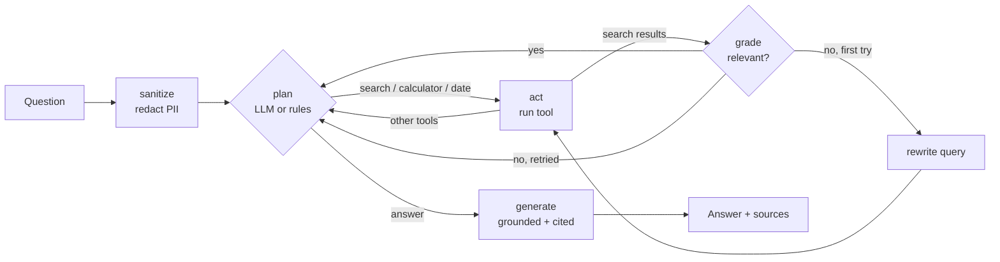

# Generative AI Agent & Semantic RAG Pipeline

A retrieval-augmented generation (RAG) pipeline with a tool-using agent, built with **Python, LlamaIndex, LangChain, LangGraph and Hugging Face**.

It answers questions from your own documents using **hybrid search** (dense vectors + BM25, merged with Reciprocal Rank Fusion), checks that retrieved context is actually relevant before answering, calls tools when a question needs them, and **redacts PII** before any text reaches a model. It runs fully offline (no API key, no model download) and upgrades to Hugging Face embeddings and a real LLM when you configure them.



## What's inside

| Piece | Built with | What it does |
|---|---|---|
| Ingestion | **LlamaIndex** `SimpleDirectoryReader` + `SentenceSplitter` | Loads `.md`/`.txt` files, redacts PII, splits into overlapping chunks. Falls back to a built-in splitter if LlamaIndex is unavailable. |
| Embeddings | **Hugging Face** `all-MiniLM-L6-v2` via `langchain-huggingface` | Semantic vectors. Falls back to a deterministic hashing embedder when the model can't be loaded (offline / CI). |
| Vector database | **Chroma** via `langchain-chroma` (or an in-memory numpy store) | Persistent cosine-similarity search. |
| Hybrid retrieval | Own BM25 + **Reciprocal Rank Fusion** | Combines semantic and keyword matches so exact terms (plan names, error codes) are not lost. |
| Agent | **LangGraph** `StateGraph` | `sanitize → plan → act → grade → rewrite → generate` with conditional edges, a step budget and no repeated tool calls. |
| LLM | **LangChain** chat models | OpenAI, Anthropic or local Ollama. With no LLM configured the agent still answers using extractive sentences. |
| Tools | Plain Python, optional LangChain `StructuredTool` wrappers | Knowledge-base search, a safe AST-based calculator, current date. |
| Privacy | `rag_agent/privacy.py` | Regex + checksum PII redaction (emails, phones, Luhn-valid cards, SSN, Aadhaar, PAN, IPs, API keys), and a strict mode that blocks hosted LLMs. |

## Quick start (offline, no API keys)

```bash
git clone https://github.com/<your-username>/genai-rag-agent.git
cd genai-rag-agent
python -m venv .venv && source .venv/bin/activate    # Windows: .venv\Scripts\activate
pip install -r requirements.txt

export EMBEDDING_BACKEND=hash     # skip the Hugging Face model download for a first run
python -m rag_agent ingest        # build the index from data/sample_docs
python -m rag_agent ask "How long does a refund take?" --trace
python -m rag_agent ask "What is 12 * 29 + 3?"
python -m rag_agent chat
python -m rag_agent eval          # retrieval metrics on data/eval_questions.json
```

Example (the sample corpus is a fictional SaaS support handbook, so questions are about refunds, SLAs, API limits, security, onboarding, incidents and pricing):

```text
$ python -m rag_agent ask "I'm jane@example.com. What credit do I get if uptime drops below 99%?" --trace
- NimbusDesk guarantees 99.9% monthly uptime for the Business and Enterprise plans and 99.5% for the Starter plan. [1]
- If monthly uptime falls below 99.9% but stays at or above 99.0%, affected customers receive a credit of 10% of that month's subscription fee. [1]
- If uptime falls below 99.0%, the credit is 25%. [1]

Sources:
  [1] sla_and_uptime.md (chunk 0)
  [2] sla_and_uptime.md (chunk 1)

(Redacted from your question before processing: {'EMAIL': 1})

Trace (local engine):
  sanitize: redacted 1 item(s) {'EMAIL': 1}
  plan[rules]: search_knowledge_base("I'm [EMAIL]. What credit do I get if uptime drops below 99%?")
  act: search_knowledge_base -> [1] sla_and_uptime.md: # Service Level Agreement and Uptime NimbusDesk guarantee
  grade: relevant=True (term coverage=1.00, max dense=0.30)
  plan[rules]: answer
  generate: extractive answer
```

(This output is offline mode with the hash embedder. With LangGraph installed the trace header reads `langgraph engine`; with an LLM configured, step 2 reads `plan[llm]` and the answer is a written sentence with citations.)

### Use semantic embeddings and a real LLM

```bash
unset EMBEDDING_BACKEND                    # use Hugging Face embeddings (downloads ~90 MB once)
python -m rag_agent ingest

pip install langchain-anthropic            # or langchain-openai / langchain-ollama
export ANTHROPIC_API_KEY=...
python -m rag_agent ask "How much would 12 Business seats cost per month?" --llm anthropic --trace
```

With an LLM configured, the model plans each step (returns a JSON action that is validated against the tool registry), and writes the final answer using only the retrieved context and tool results, with `[n]` citations. If the model is unreachable or returns junk, the agent falls back to rule-based planning and extractive answers instead of failing.

## Configuration

Set environment variables or copy `.env.example` to `.env`. CLI flags (`--embeddings`, `--store`, `--llm`, `--privacy`, `--index-dir`, `--data-dir`) override them.

| Variable | Default | Meaning |
|---|---|---|
| `RAG_DATA_DIR` | `data/sample_docs` | Folder of `.md` / `.txt` / `.rst` files to index |
| `RAG_INDEX_DIR` | `index` | Where the index is stored |
| `EMBEDDING_BACKEND` | `auto` | `auto` (Hugging Face, else hash), `huggingface`, `hash` |
| `EMBEDDING_MODEL` | `sentence-transformers/all-MiniLM-L6-v2` | Any sentence-transformers model |
| `VECTOR_STORE` | `auto` | `auto` (Chroma if installed), `chroma`, `memory` |
| `LLM_PROVIDER` / `LLM_MODEL` | `none` | `none`, `openai`, `anthropic`, `ollama` and an optional model name |
| `AGENT_ENGINE` | `langgraph` | `langgraph` or `local` (same nodes, minimal executor) |
| `PRIVACY_MODE` | `standard` | `strict` refuses hosted LLM providers |
| `REDACT_PII` | `true` | Redact documents at ingest, questions before planning, and answers |
| `CHUNK_SIZE` / `CHUNK_OVERLAP` | `90` / `15` | Chunking (LlamaIndex counts tokens; the fallback splitter counts words) |
| `TOP_K`, `MAX_AGENT_STEPS` | `4`, `4` | Retrieved chunks and tool-call budget |
| `MIN_COVERAGE`, `MIN_DENSE` | `0.5`, `0.45` | Relevance-gate thresholds |

## How it works

**Hybrid retrieval.** Each query runs against the vector store (cosine similarity) and a BM25 index. The two ranked lists are merged with Reciprocal Rank Fusion, `score(d) = Σ 1 / (60 + rank)`, so a chunk ranked well by both methods wins and neither method's score scale matters.

**Relevance gate.** After each search the agent checks whether a top chunk contains enough of the question's *informative* terms (terms that exist in the corpus but are not in most documents) or is close enough in embedding space. If not, it rewrites the query once and retries. If it is still not relevant, it answers *"I couldn't find that in the knowledge base"* instead of guessing.

**Tool use.** The planner picks `search_knowledge_base`, `calculator` or `current_date`. Decisions are parsed from JSON and rejected unless they name a registered tool; the first step must be a tool call (answers are always grounded); an identical call is never repeated; and a step budget guarantees termination. The calculator evaluates an AST allow-list, never `eval`. `rag_agent.tools.as_langchain_tools` exposes the same tools as LangChain `StructuredTool`s if you prefer native tool calling.

**Privacy.** Documents are redacted before they are chunked or embedded, the question is redacted before planning (so no model, log or trace sees it), and the final answer is redacted again in case a model repeats something. Set `PRIVACY_MODE=strict` to forbid OpenAI/Anthropic entirely and keep everything on your machine (Ollama or the offline mode). Redaction is pattern-based: it catches common identifier formats, not names or free-text secrets, so treat it as one layer of defence rather than a guarantee.

## Evaluation

`python -m rag_agent eval` measures hit@1, hit@3 and MRR (document-level) for dense, BM25 and hybrid search on `data/eval_questions.json` (20 labelled questions). On the bundled corpus with the offline hash embedder:

| mode | hit@1 | hit@3 | MRR |
|---|---|---|---|
| dense | 0.90 | 1.00 | 0.95 |
| bm25 | 1.00 | 1.00 | 1.00 |
| hybrid | 1.00 | 1.00 | 1.00 |

These numbers are for a tiny 7-document, 14-chunk corpus and a lexical embedder, so they show the harness works rather than how the system performs on real data. Replace `data/sample_docs` and `data/eval_questions.json` with your own documents and questions, re-ingest with Hugging Face embeddings, and report those numbers.

## Project layout

```text
rag_agent/
  config.py        settings from environment variables
  ingest.py        loading (LlamaIndex) and chunking, PII redaction at ingest
  embeddings.py    Hugging Face and offline hash embedders
  vectorstores.py  Chroma (LangChain) and in-memory vector stores
  retrieval.py     BM25, Reciprocal Rank Fusion, KnowledgeBase
  privacy.py       PII redaction and privacy-mode guard
  tools.py         search, calculator, date tools
  llm.py           OpenAI / Anthropic / Ollama chat model factory
  agent.py         LangGraph agent: nodes, routing, relevance gate
  evaluate.py      hit@k / MRR evaluation
  cli.py           ingest | ask | chat | eval
data/              sample documents and labelled evaluation questions
tests/             unit and integration tests
```

## Tests

```bash
pip install -r requirements.txt -r requirements-dev.txt
python -m pytest            # or: python -m unittest discover -s tests -t .
```

The core (privacy, chunking, BM25, fusion, retrieval, agent logic, calculator) is tested with the offline embedder and needs no network. Tests for LlamaIndex, Chroma, LangGraph, LangChain tools and Hugging Face embeddings skip themselves when the corresponding package or model is unavailable, and the LangGraph test checks that the compiled graph returns the same answers as the local executor.

## Limitations

- Offline mode returns the best-matching sentences rather than a written answer, and the hash embedder is lexical, not semantic. Use Hugging Face embeddings and an LLM for real use.
- Tool selection is prompt-based JSON routing, not a provider's native function-calling API.
- The index is rebuilt from scratch on every `ingest`, and `ingest` must be re-run if you change the embedding backend.
- Only text formats (`.md`, `.txt`, `.rst`) are loaded; add LlamaIndex readers for PDFs or Office files.

## License

MIT, see [LICENSE](LICENSE).
